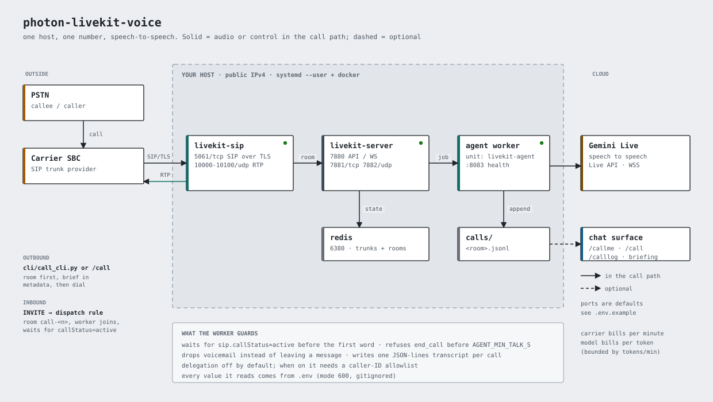
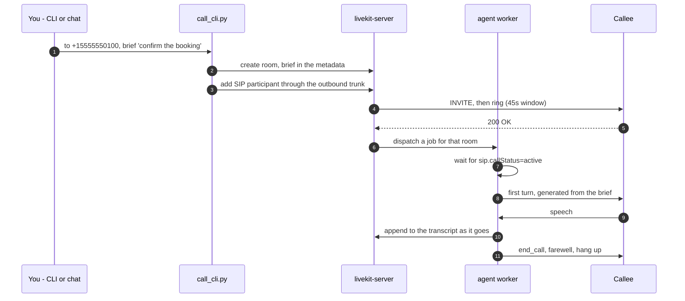
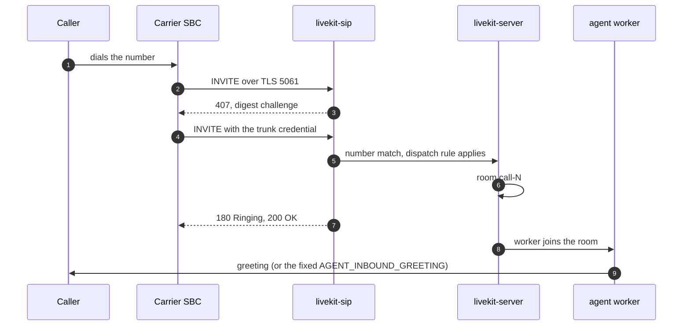

# photon-livekit-voice

A telephone agent you can actually call. LiveKit carries the audio, a carrier
trunk connects it to the phone network, and Gemini Live does the talking - speech
to speech, no separate STT/TTS chain. It places outbound calls, answers inbound
ones, writes a transcript of each, and can post a short briefing about what
happened back into your chat.

Self-hosted: one Linux box with docker, a public IP and a SIP number. No SaaS in
the audio path except the model.



*One host. The carrier reaches `livekit-sip` on 5061/tcp and sends RTP to
10000-10100/udp; everything else is loopback. Full-size image:
[docs/architecture.svg](docs/architecture.svg).*

## What you get

- **Outbound calls** from a CLI or a chat command, with a brief the agent follows.
  Ring is non-blocking, so a slow carrier does not time the call out.
- **Inbound calls** answered by the agent, with delegation off by default.
- **A transcript per call** (`calls/<room>.jsonl`: `call`, `answered`, `said`,
  `heard`, `ended`), which is what the briefing is built from.
- **Guards that came from real failures**: the agent waits for the line to be
  actually answered before speaking, refuses to hang up early, drops voicemail
  rather than leaving a message, and never leaves a caller hearing silence.
- **Gates instead of a script.** Each install step verifies the layer below it and
  stops at the first failure, because every failure mode here is silent.
- **Tests that need no phone line**: a room test (driverless audio check) and an
  inbound simulation that plays the carrier's SBC over TLS.

## How a call flows

Outbound - the room exists before the phone rings, so the brief is waiting when
the call is answered:



Inbound - the trunk challenges before it will accept anything, and the dispatch
rule is what turns an INVITE into a room:



RTP flows both ways alongside those messages; if the media range is not open in
both firewall layers, the call sets up and carries no audio.

## What it is not

- Not a hosted service. You run it; you pay the carrier per minute and the model
  per token.
- Not multi-tenant. One number, one agent, one owner.
- Not telephony-provider specific in principle, but the installer automates
  **Photon** (photon.codes) and expects a LiveKit-compatible SIP trunk elsewhere.

## Requirements

**Host**

- Linux with docker + compose v2, `systemd --user` with linger enabled
  (`loginctl enable-linger $USER`) - the worker is a user unit.
- A public IPv4 and a DNS name pointing at it, for inbound. Outbound alone works
  behind NAT.
- The DNS record must be **grey cloud / DNS-only**. A proxied record breaks SIP
  with no error.
- Open inbound: `5061/tcp` (SIP over TLS), `10000-10100/udp` (RTP). Both the cloud
  security list and the host firewall - two layers, both easy to forget.
- Ports used locally: `7880` API/WS, `7881/tcp` RTC, `7882/udp` media, `5060`
  plain SIP, `6380` redis, `8083` worker health.
- Python 3.10+ (the installer prefers `uv` and pins CPython 3.10 for the venv).

**Accounts**

| Thing | Why | Where |
| --- | --- | --- |
| A SIP number with a voice-eligible line | the phone number itself | Photon (or any LiveKit SIP trunk provider) |
| A Gemini API key | speech-to-speech | aistudio.google.com |
| DNS + a certificate | the carrier connects over TLS | your DNS host; DNS-01 via Cloudflare is automated |

A certificate is issued by `bootstrap/cert-acme.sh` (Let's Encrypt, DNS-01 by
default so port 80 never opens). It must be publicly trusted: a self-signed cert
is fine for testing but a carrier will refuse it.

**Cost**: carrier per minute, model per token (Live's free tier is bounded by
**tokens per minute**, so overlapping calls fail with error 1011), plus the box.

## Quick start

```bash
git clone <this repo> photon-livekit-voice && cd photon-livekit-voice

cp .env.example .env && chmod 600 .env
$EDITOR .env                     # fill the six required keys, see below

bash install.sh                  # gates 0-5, stops at the first failure
```

The six keys that matter on a first run - everything else has a working default:

```ini
SIP_DOMAIN=sip.example.com       # your DNS name, grey-cloud A record
ACME_EMAIL=you@example.com       # where the CA reaches you
CLOUDFLARE_API_TOKEN=            # only for DNS-01 issuance; else leave empty
GEMINI_API_KEY=AIza...           # aistudio.google.com/apikey
PHOTON_API_KEY=                  # provider dashboard
PHOTON_PROJECT_ID=pho_prj_...    # provider dashboard URL
PHOTON_VOICE_PROFILE_ID=pho_vpf_...
```

`LIVEKIT_API_KEY`/`SECRET` are generated for you; leave them blank.

Then check it without spending a cent:

```bash
venv/bin/python tests/room_test.py        # the agent speaks into a room, no telephony
venv/bin/python tests/inbound_sim.py      # a fake carrier INVITE, no phone line
bash install.sh --check                   # the whole ladder, read-only
```

## The gates

`install.sh` runs them in order. Each one can also be run alone; none of them
print a credential (lengths and masked values only).

| Gate | Command | Proves |
| --- | --- | --- |
| 0 | `python3 bootstrap/00-preflight.py` | config parses, DNS resolves to this host, the cert covers `SIP_DOMAIN`, ports are free, the provider line is voice-eligible |
| 1 | `bash bootstrap/10-stack.sh` | redis + livekit-server + livekit-sip are up and the API answers on 7880 |
| 2 | `bash bootstrap/40-agent.sh --no-unit` then `venv/bin/python bootstrap/20-sip-objects.py` | the worker venv exists (this gate imports the SDK), the inbound trunk and dispatch rule exist, and the trunk's credential equals `.env` |
| 3 | `venv/bin/python bootstrap/30-photon.py` | the provider issued an outbound credential, the LiveKit outbound trunk exists, and the provider's inbound destination points back at this host |
| 4 | `bash bootstrap/40-agent.sh` | the worker venv is built, the unit is installed and enabled, and **"registered worker" appears in the log** |
| 5 | `bash bootstrap/50-dialer.sh` | the dialer can reach the API and sees the trunk with the right address |

Gate 3 writes to the provider. Run it on the host that should receive calls, and
nowhere else - on a test box it will point your live number at the test box.

## Placing a call

```bash
# your own number, no brief (needs OWNER_NUMBER in .env)
venv/bin/python cli/call_cli.py --mode callme

# someone else, with a brief the agent follows
venv/bin/python cli/call_cli.py --to +15555550100 \
  --instruction 'ask whether they are open on Saturday and until what time'

# local number, expanded with DEFAULT_COUNTRY_CODE
venv/bin/python cli/call_cli.py --to 0456789012 --instruction 'confirm the booking'

# what is already in the trunk, no call
venv/bin/python cli/call_cli.py --list
```

`--wait` holds the process until the call ends, `--json` gives machine-readable
output, `--ring-timeout` changes the 45s window, `--mode room` creates a room with
no phone leg.

The order matters: the room is created first with the brief in its metadata, then
the phone leg is added. If the dial times out the room stays, and the transcript
tells you why.

## Receiving a call

Inbound needs the same trunk plus a dispatch rule that turns an INVITE into a room
(`ROOM_PREFIX`, default `call-`). Gate 2 creates both; gate 3 tells the provider
where to send calls.

```bash
# prove the whole inbound path with no phone line and no provider
venv/bin/python tests/inbound_sim.py
```

It opens TLS to `5061`, sends an INVITE for the number the trunk owns, answers the
trunk's `407` digest challenge with the trunk's own credential, then asserts:
`200 OK` → the dispatch rule created a room → the worker joined → the agent greeted
→ the transcript has `call`, `answered`, `said`. Seven checks, exit code 1 on any
failure.

What it cannot prove - and what the gate table calls host/provider items: public
DNS, a certificate the carrier trusts, published ports, and the provider's inbound
destination.

**Delegation is off by default.** Anyone who can reach the number can talk to the
agent; by default it can only talk back. Enabling delegation lets a caller drive a
local agent session, so it requires an explicit allowlist:

```ini
AGENT_DELEGATION_ENABLED=true
AGENT_DELEGATION_ALLOWLIST=+15555550100,+15555550101   # last 9 digits are compared
```

With delegation on and an empty allowlist every caller is allowed. Do not do that.

## Chat commands (optional)

```bash
bash surface/hermes-plugin/install.sh
```

Adds three commands to a Hermes profile:

```
/callme [why]            ring your own phone
/call <number> <reason>  ring that number with the reason as the brief
/calllog [room]          reprint a call's transcript
```

The plugin shells out to `cli/call_cli.py` (set `PHOTON_VOICE_DIR` if the repo
lives elsewhere) and starts a watcher that polls the transcript and posts a
briefing into the same conversation when the call ends. Two prerequisites in
Hermes config:

```yaml
plugins:
  entries:
    voice-call:
      enabled: true
      allow_gateway_injection: true     # posting into a live conversation is privileged
```

Without Hermes, everything still works from the CLI - the plugin is a surface, not
the product.

## Configuration

`.env.example` is the reference: every key, what it does, where the value comes
from, and a sample shape. Copy it to `.env` and treat that as the only source of
truth - the compose file, the gates, the worker and the plugin all read it.

The settings worth knowing:

| Key | Default | Effect |
| --- | --- | --- |
| `AGENT_MIN_TALK_S` | 12 | `end_call` is refused until the agent has spoken and the line has been up this long |
| `AGENT_MACHINE_MIN_S` | 6 | a "this is a machine" verdict may hang up earlier, but never sooner than this |
| `AGENT_HANGUP_GRACE_S` | 3.5 | the line stays up briefly after `end_call`, so the farewell is not cut off |
| `AGENT_S2S_VOICE` | Puck | Gemini Live voice |
| `DEFAULT_COUNTRY_CODE` | 61 | expands local-form numbers typed into `/call` |
| `SIP_ALLOWED_ADDRESSES` | empty | restrict inbound to carrier IPs/CIDRs |

Configs are rendered from `templates/` by `bootstrap/render.py`, which refuses to
write a file that still contains a `__PLACEHOLDER__` and chmods credential-bearing
files 600. Do not hand-edit `livekit.yaml`, `sip.yaml` or `docker-compose.yaml` -
they are generated and gitignored.

## Troubleshooting

Full symptom → layer → fix table: [docs/TROUBLESHOOTING.md](docs/TROUBLESHOOTING.md).
The ones that catch everybody:

- **Calls connect but nobody hears the agent.** RTP range not open inbound, or the
  greeting fired before the line was answered. The agent waits for
  `sip.callStatus=active`; check the RTP range in *both* firewall layers.
- **Silence mid-call, then the call dies.** Gemini Live error 1011 - the
  tokens-per-minute ceiling. Serialise calls; nothing else fixes it.
- **Outbound fails instantly with 401.** Trunk credential does not match the
  provider. Gate 2 compares them; re-run gate 3 to re-sync.
- **Inbound rings and 403s.** The provider's inbound destination does not point at
  this host, or its credential differs from the trunk's. Gate 3 sets both; the
  ladder checks both.
- **The briefing never appears in chat.** The transcript directory the plugin reads
  differs from the worker's, or `allow_gateway_injection` is off.

## Security

`.env`, `certs/`, `calls/` and every rendered config are gitignored, written 600,
and `scripts/secret-scan.py` proves it - it scans the files a push would send, the
full commit history, and matches against the live values in your `.env`.
`scripts/install-hooks.sh` wires that into `pre-commit` and `pre-push`, and
`.github/workflows/secret-scan.yml` runs it again on every push.

Full model - what holds a secret, rotation order per credential, what to do if one
leaks: [SECURITY.md](SECURITY.md).

## Project layout

```
install.sh                     six gates, in order, stop at the first failure
bootstrap/00-preflight.py      gate 0  config, DNS, cert, ports, provider line
bootstrap/10-stack.sh          gate 1  renders configs, starts the stack
bootstrap/20-sip-objects.py    gate 2  inbound trunk + dispatch rule + credential check
bootstrap/30-photon.py         gate 3  provider credential + inbound destination
bootstrap/40-agent.sh          gate 4  worker venv, systemd unit, registration
bootstrap/50-dialer.sh         gate 5  the dialer's view of the trunk
bootstrap/90-check.py          the ladder, read-only, 20 checks
bootstrap/cert-acme.sh         certificate over DNS-01
bootstrap/render.py            templates -> configs, mode 600, refuses placeholders
agent/agent.py                 the voice worker (speech to speech)
agent/env.py                   dependency-free .env loader
cli/call_cli.py                the dialer
surface/cli/voice              thin shell wrapper around the dialer
surface/hermes-plugin/         /callme, /call, /calllog + the briefing watcher
tests/                         room test, inbound sim, briefing tests, probes
templates/                     compose, livekit.yaml, sip.yaml, systemd unit
scripts/                       secret-scan.py, install-hooks.sh
docs/TROUBLESHOOTING.md        symptom -> layer -> fix
SECURITY.md                    secret model, rotation, disclosure
SKILLS.md                      agent-facing playbook: run it, verify it, fix it
```

## Pinned versions

`requirements.txt` pins the SDK on purpose. `livekit-agents` and its plugins move
fast, and the answered-gate depends on a protocol-level participant attribute, so a
silent minor bump can change call behaviour without breaking the install. Bump one
line at a time and re-run `bootstrap/90-check.py` and the two telephony-free tests
before trusting it.

Server images are pinned by tag in `.env` (`LIVEKIT_SERVER_TAG`,
`LIVEKIT_SIP_TAG`) for the same reason.

## Licence

MIT - see [LICENSE](LICENSE).
